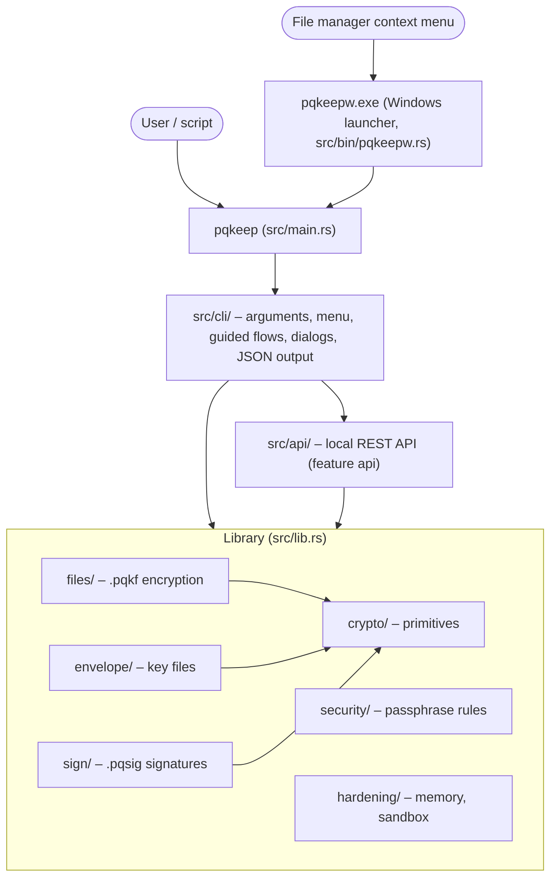
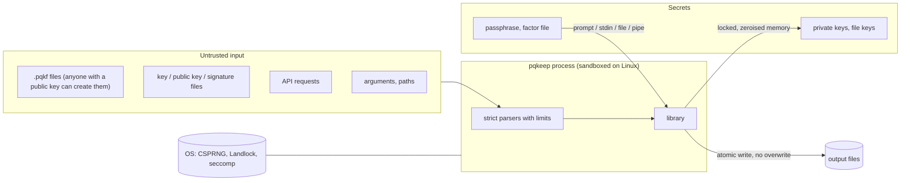

# Architecture / Architektur

[English](#english) | [Deutsch](#deutsch)

## English

A map of the code for newcomers: what lives where, how a command flows through the program, where
the trust boundaries are and which rules must hold when you change something. Details are in the
linked documents; the binding requirements are in the specification
([EN](docs/SPEC.en.md), [DE](docs/SPEC.md)).

### Big picture

PQKeep is **one Rust crate** with a library (`src/lib.rs`) and two binaries. All cryptography,
formats and file handling live in the library; the binaries only parse input, ask for secrets and
call the library.

### Where is what

| Path | Responsibility | Start reading |
|---|---|---|
| `src/crypto/` | ML-KEM, ML-DSA (RustCrypto crates), AES-256-GCM, Argon2id, STREAM construction, key wrapping, factor file, v2 key derivation, secret containers, OS randomness | `mod.rs`, `secret.rs`, `stream.rs` |
| `src/envelope/` | Key files (`*.key.json`, v1 and v2) and public key files: strict JSON parsing, metadata, timestamps, size limits, permission checks | `mod.rs`, `keyfile.rs`, `parse.rs` |
| `src/files/` | Encrypted files and folders (`.pqkf`): binary header v1/v2, access slots, archive format, path rules, walking the source, safe output, `check` | `mod.rs`, `encrypt.rs`, `decrypt.rs`, `format.rs` |
| `src/sign/` | Detached ML-DSA-87 signatures (`.pqsig`) over SHA3-512 | `mod.rs`, `format.rs` |
| `src/security/` | Passphrase strength (NFKC, patterns, word lists, entropy), generator | `mod.rs`, `policy.rs` |
| `src/hardening/` | Memory locking, core dump block, Linux sandbox (Landlock + seccomp profiles and system call lists) | `mod.rs`, `sandbox/mod.rs` |
| `src/api/` | REST API (`pqkeep serve`, feature `api`): token, rate limit, guards, handlers | `mod.rs` |
| `src/cli/` | Everything user-facing: argument definitions, commands, interactive menu, guided flows (`guide/`), context menu and windows (`context*`, `dialog/`), `integrate` (file manager entries), texts DE/EN, `--json` | `mod.rs`, `args.rs`, `files_cmd.rs` |
| `src/fsutil.rs`, `src/error.rs` | Atomic writing; central error type without secrets | |
| `tests/` | Integration tests, grouped by prefix: `crypto_*`, `envelope_*`, `files_*`, `sign_*`, `security_*`, `hardening_*`, `sandbox_*`, `api_*`, `cli_*`; known-answer vectors in `tests/kat/` | `tests/common/mod.rs` |
| `fuzz/` | `cargo-fuzz` targets for all parsers (key files, public keys, `.pqkf` headers v1/v2, archive paths, stream tampering, passphrases, API requests) | |
| `scripts/` | Line-limit check, workflow policy, release packaging and checks, v2 reference implementation in Python | `check_limits.sh` |
| `docs/` | Formats, threat model, sandbox, API, release, CI security | see the README table |

Unit tests of internal functions live next to the module as `<module>_tests.rs`; production files
contain no `#[test]`.

### How a command flows

1. `main.rs` → `cli::run()`: process hardening first (`hardening::harden_process`: no core dumps,
   not dumpable on Linux), root warning. Memory holding secrets is locked per secret
   (`hardening/memlock.rs`).
2. Without arguments in a terminal the **menu** starts. Each menu action runs as a **separate
   `pqkeep` process** – the menu process itself never handles passphrases or keys.
3. With arguments: `clap` parses (`cli/args.rs`). Guided flows (missing input in a terminal) also
   start separate processes.
4. **Sandbox before any input:** `cli/access.rs` computes exactly the paths this command may touch;
   `hardening/sandbox` applies Landlock and seccomp. From here on the process cannot open other
   files, start programs or use the network (Linux).
5. Secrets are read (`cli/io.rs`, `cli/unlock.rs`): hidden prompt, `--passphrase-stdin` or
   `--passphrase-file` – never arguments or environment variables.
6. The library does the work, e.g. `files::encrypt`: walk the source → archive → STREAM
   (AES-256-GCM, 64 KiB chunks) → temporary file → rename only after success; never overwrite.
7. Output as text or one JSON object (`--json`, `docs/JSON.md`) with stable exit codes 0–7.

The **context menu** (`integrate`) starts `pqkeep context …` (Linux) or `pqkeepw.exe` (Windows); the
passphrase window (zenity/kdialog or PowerShell) hands the passphrase over a pipe to a child
process that runs with the full sandbox (`docs/INTEGRATION.md`).

The **API** (`pqkeep serve`) opens its token file and socket before the sandbox, then may only
`accept` on that socket; it offers key generation and passphrase checks, never file encryption
(`docs/API.md`).

### Trust boundaries

| STRIDE | Example in PQKeep | Main controls |
|---|---|---|
| Spoofing | foreign public key or forged API client | fingerprints checked out of band; API token (hash only, constant-time compare, lockout) |
| Tampering | manipulated `.pqkf`, key file or signature | AEAD with the full header as AAD, STREAM, strict parsers, downgrade checks |
| Repudiation | who signed a file? | ML-DSA signatures with key ID; not an eIDAS signature |
| Information disclosure | secrets in logs, swap, arguments | no secrets in errors/logs/argv/env, memory locking, zeroisation (best effort) |
| Denial of service | huge headers, Argon2 parameters, API floods | upper bounds when reading, API limits and memory budget |
| Elevation of privilege | exploit in a parser | Linux sandbox per command, no `unsafe`, fuzzing |

Full threat model: [`docs/THREAT_MODEL.md`](docs/THREAT_MODEL.md); CI and release:
[`docs/security/CI_SECURITY.md`](docs/security/CI_SECURITY.md).

### Rules that must hold when you change code

- **No `unsafe`** (`#![forbid(unsafe_code)]`), no `unwrap`/`expect` in production code.
- **Secrets** only in the secret types (`crypto/secret.rs`); never in `Debug`, errors, logs,
  arguments or environment variables.
- **New file access or system call?** Update `cli/access.rs` or the lists in
  `hardening/sandbox/syscalls.rs` – otherwise the command fails under the sandbox on Linux.
  `docs/SANDBOX.md` explains how the lists are derived.
- **Formats** are versioned: readers have upper limits and reject unknown versions; existing
  files must stay readable (v1 is still written when it is enough).
- **Output** is atomic and never overwrites (`fsutil.rs`, `files/output.rs`).
- **Limits:** production files ≤ 300 lines, functions ≤ 50, test files ≤ 400
  (`scripts/check_limits.sh`); comments and texts DE/EN (external contributions: English is enough).

### Planned changes (risk and migration)

| Change | Issue | Risk | How compatibility is kept |
|---|---|---|---|
| Versioned core API | #98 | callers break | adapter over the existing functions first |
| Core as its own crate | #99 | crates.io users, build | same formats and key semantics; CLI uses an adapter |
| Optional local daemon and IPC | #100, #101 | new attack surface | separate binary, opt-in, Unix socket/named pipe with peer checks |
| Sender signature in `.pqkf` | #44 | format change | new format version with downgrade protection; unsigned files unchanged |
| Stream mode (`--stdin`) | #83 | truncation | new content type; decrypt only into files |

---

## Deutsch

Ein Wegweiser durch den Code für Neue: was wo liegt, wie ein Befehl durch das Programm läuft, wo
die Vertrauensgrenzen sind und welche Regeln bei Änderungen gelten müssen. Einzelheiten stehen in
den verlinkten Dokumenten; verbindlich ist die Spezifikation ([DE](docs/SPEC.md),
[EN](docs/SPEC.en.md)).

### Überblick

PQKeep ist **eine Rust-Crate** mit einer Bibliothek (`src/lib.rs`) und zwei Programmen. Alle
Kryptografie, Formate und Dateiverarbeitung liegen in der Bibliothek; die Programme lesen nur
Eingaben, fragen Geheimnisse ab und rufen die Bibliothek auf (Diagramm im englischen Teil).

### Was liegt wo

| Pfad | Aufgabe | Einstieg |
|---|---|---|
| `src/crypto/` | ML-KEM, ML-DSA (RustCrypto-Crates), AES-256-GCM, Argon2id, STREAM-Konstruktion, Einpacken von Schlüsseln, Faktordatei, v2-Ableitung, Geheimnis-Typen, Zufall vom Betriebssystem | `mod.rs`, `secret.rs`, `stream.rs` |
| `src/envelope/` | Schlüsseldateien (`*.key.json`, v1 und v2) und öffentliche Schlüssel: strenges JSON-Parsen, Metadaten, Zeitstempel, Größengrenzen, Rechteprüfung | `mod.rs`, `keyfile.rs`, `parse.rs` |
| `src/files/` | Verschlüsselte Dateien und Ordner (`.pqkf`): Binär-Header v1/v2, Zugänge, Archivformat, Pfadregeln, Einlesen der Quelle, sichere Ausgabe, `check` | `mod.rs`, `encrypt.rs`, `decrypt.rs`, `format.rs` |
| `src/sign/` | Abgesetzte ML-DSA-87-Signaturen (`.pqsig`) über SHA3-512 | `mod.rs`, `format.rs` |
| `src/security/` | Passphrase-Stärke (NFKC, Muster, Wortlisten, Entropie), Generator | `mod.rs`, `policy.rs` |
| `src/hardening/` | Speichersperre, Core-Dump-Sperre, Linux-Sandbox (Landlock + Seccomp, Profile und Systemaufruf-Listen) | `mod.rs`, `sandbox/mod.rs` |
| `src/api/` | REST-API (`pqkeep serve`, Feature `api`): Token, Rate-Limit, Schutzschichten, Endpunkte | `mod.rs` |
| `src/cli/` | Alles, was Nutzer sehen: Argumente, Befehle, Menü, geführte Abläufe (`guide/`), Kontextmenü und Fenster (`context*`, `dialog/`), `integrate` (Dateimanager-Einträge), Texte DE/EN, `--json` | `mod.rs`, `args.rs`, `files_cmd.rs` |
| `src/fsutil.rs`, `src/error.rs` | Atomares Schreiben; zentraler Fehlertyp ohne Geheimnisse | |
| `tests/` | Integrationstests nach Präfix: `crypto_*`, `envelope_*`, `files_*`, `sign_*`, `security_*`, `hardening_*`, `sandbox_*`, `api_*`, `cli_*`; Testvektoren in `tests/kat/` | `tests/common/mod.rs` |
| `fuzz/` | `cargo-fuzz`-Ziele für alle Parser (Schlüsseldateien, öffentliche Schlüssel, `.pqkf`-Header v1/v2, Archivpfade, Stream-Manipulation, Passphrasen, API-Anfragen) | |
| `scripts/` | Zeilenlimit-Prüfung, Workflow-Regeln, Release-Pakete und -Prüfungen, v2-Referenz in Python | `check_limits.sh` |
| `docs/` | Formate, Bedrohungsmodell, Sandbox, API, Release, CI-Sicherheit | siehe Tabelle in der README |

Unit-Tests interner Funktionen liegen neben dem Modul als `<modul>_tests.rs`; Produktionsdateien
enthalten kein `#[test]`.

### Wie ein Befehl abläuft

1. `main.rs` → `cli::run()`: zuerst Prozesshärtung (`hardening::harden_process`: keine Core-Dumps,
   unter Linux „nicht dumpbar“), Warnung bei root. Speicher mit Geheimnissen wird je Geheimnis
   gesperrt (`hardening/memlock.rs`).
2. Ohne Argumente im Terminal startet das **Menü**. Jede Menü-Aktion läuft als **eigener
   `pqkeep`-Prozess** – der Menü-Prozess selbst verarbeitet nie Passphrasen oder Schlüssel.
3. Mit Argumenten: `clap` parst (`cli/args.rs`). Geführte Abläufe (fehlende Angaben im Terminal)
   starten ebenfalls eigene Prozesse.
4. **Sandbox vor jeder Eingabe:** `cli/access.rs` bestimmt genau die Pfade dieses Befehls;
   `hardening/sandbox` setzt Landlock und Seccomp. Ab hier kann der Prozess keine anderen Dateien
   öffnen, keine Programme starten und nicht ins Netz (Linux).
5. Geheimnisse werden gelesen (`cli/io.rs`, `cli/unlock.rs`): verdeckte Eingabe,
   `--passphrase-stdin` oder `--passphrase-file` – nie Argumente oder Umgebungsvariablen.
6. Die Bibliothek arbeitet, z. B. `files::encrypt`: Quelle einlesen → Archiv → STREAM
   (AES-256-GCM, 64-KiB-Blöcke) → temporäre Datei → Umbenennen erst nach Erfolg; nie überschreiben.
7. Ausgabe als Text oder als ein JSON-Objekt (`--json`, `docs/JSON.md`) mit festen Exit-Codes 0–7.

Das **Kontextmenü** (`integrate`) startet `pqkeep context …` (Linux) bzw. `pqkeepw.exe` (Windows);
das Passwortfenster (zenity/kdialog bzw. PowerShell) gibt die Passphrase per Pipe an einen
Kindprozess mit voller Sandbox (`docs/INTEGRATION.md`).

Die **API** (`pqkeep serve`) öffnet Token-Datei und Socket vor der Sandbox und darf danach nur noch
auf diesem Socket `accept` aufrufen; sie bietet Schlüsselerzeugung und Passphrase-Prüfung, nie
Dateiverschlüsselung (`docs/API.md`).

### Vertrauensgrenzen

Nicht vertrauenswürdig sind alle Eingaben: `.pqkf`-Dateien (jeder mit einem öffentlichen Schlüssel
kann sie erzeugen), Schlüssel- und Signaturdateien, API-Anfragen, Argumente und Pfade. Sie gehen
nur durch strenge Parser mit Grenzen. Geheimnisse (Passphrase, Faktordatei, private Schlüssel,
Dateischlüssel) kommen nur über Eingabeaufforderung, stdin, Datei oder Pipe herein und liegen in
gesperrtem, nach Gebrauch genulltem Speicher. Ausgaben werden atomar geschrieben, nie
überschrieben. Diagramm und STRIDE-Tabelle stehen im englischen Teil; vollständiges
Bedrohungsmodell: [`docs/THREAT_MODEL.md`](docs/THREAT_MODEL.md), CI und Release:
[`docs/security/CI_SECURITY.md`](docs/security/CI_SECURITY.md).

| STRIDE | Beispiel | Wichtigste Maßnahmen |
|---|---|---|
| Vortäuschen | fremder öffentlicher Schlüssel, gefälschter API-Client | Fingerabdruck auf zweitem Weg prüfen; API-Token (nur Hash, Vergleich in konstanter Zeit, Sperre) |
| Manipulation | veränderte `.pqkf`-, Schlüssel- oder Signaturdatei | AEAD mit ganzem Header als AAD, STREAM, strenge Parser, Downgrade-Prüfung |
| Abstreiten | wer hat signiert? | ML-DSA-Signatur mit Schlüssel-ID; keine eIDAS-Signatur |
| Preisgabe | Geheimnisse in Logs, Swap, Argumenten | keine Geheimnisse in Fehlern/Logs/argv/env, Speichersperre, Nullen (best effort) |
| Überlastung | riesige Header, Argon2-Parameter, API-Flut | Obergrenzen beim Lesen, API-Grenzen und Speicherbudget |
| Rechteausweitung | Lücke in einem Parser | Linux-Sandbox je Befehl, kein `unsafe`, Fuzzing |

### Regeln bei Änderungen am Code

- **Kein `unsafe`** (`#![forbid(unsafe_code)]`), kein `unwrap`/`expect` im Produktionscode.
- **Geheimnisse** nur in den Geheimnis-Typen (`crypto/secret.rs`); nie in `Debug`, Fehlern, Logs,
  Argumenten oder Umgebungsvariablen.
- **Neuer Dateizugriff oder Systemaufruf?** `cli/access.rs` bzw. die Listen in
  `hardening/sandbox/syscalls.rs` anpassen – sonst scheitert der Befehl unter Linux in der Sandbox.
  Wie die Listen entstehen, steht in `docs/SANDBOX.md`.
- **Formate** sind versioniert: Leser haben Obergrenzen und lehnen unbekannte Versionen ab;
  vorhandene Dateien bleiben lesbar (v1 wird weiter geschrieben, wenn es genügt).
- **Ausgabe** atomar, nie überschreiben (`fsutil.rs`, `files/output.rs`).
- **Grenzen:** Produktionsdateien ≤ 300 Zeilen, Funktionen ≤ 50, Testdateien ≤ 400
  (`scripts/check_limits.sh`); Kommentare und Texte DE/EN (externe Beiträge: Englisch genügt).

### Geplante Änderungen (Risiko und Übergang)

| Änderung | Issue | Risiko | Wie Kompatibilität erhalten bleibt |
|---|---|---|---|
| Versionierte Core-API | #98 | Aufrufer brechen | zuerst Adapter über die vorhandenen Funktionen |
| Kern als eigene Crate | #99 | crates.io-Nutzer, Build | gleiche Formate und Schlüsselsemantik; CLI über Adapter |
| Optionaler lokaler Daemon und IPC | #100, #101 | neue Angriffsfläche | eigenes Programm, opt-in, Unix-Socket/Named Pipe mit Prüfung der Gegenseite |
| Absender-Signatur in `.pqkf` | #44 | Formatänderung | neue Formatversion mit Downgrade-Schutz; unsignierte Dateien unverändert |
| Strom-Modus (`--stdin`) | #83 | Abschneiden | neuer Inhaltstyp; Entschlüsseln nur in Dateien |
