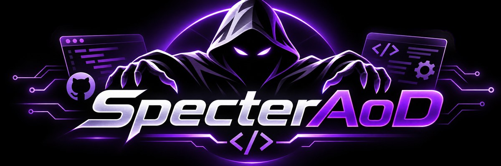

# PQKeep

**Post-quantum keys, kept simple and documented.**

[](https://github.com/SpecterAoD/pqkeep/actions/workflows/ci.yml)
[](https://github.com/SpecterAoD/pqkeep/releases)
[](LICENSE)
[](https://scorecard.dev/viewer/?uri=github.com/SpecterAoD/pqkeep)
[](https://www.bestpractices.dev/projects/16717)
[](https://github.com/sponsors/SpecterAoD)
[](https://ko-fi.com/specteraod)

[English](#english) | [Deutsch](#deutsch)

> **Status: beta (`v0.1.0-beta.3`) – not audited, not FIPS 140 validated.**
> File formats and options may still change before 1.0. Please do not use PQKeep to protect
> secrets you cannot afford to lose. See [Status and limitations](#status-and-limitations).

---

## English

### What PQKeep does

PQKeep **encrypts files and folders and signs documents** with the new post-quantum standards
from NIST. Data you encrypt today should stay confidential even once quantum computers can break
today's common public-key encryption ("harvest now, decrypt later").

- Protect a file or a whole folder with a passphrase – optionally plus a second factor (a factor
  file, e.g. on a USB stick) – or for one or more people via their public key.
- Sign documents and verify signatures.
- Check encrypted backups completely without unpacking them.
- Runs **locally** on Linux and Windows: no cloud, no account, no telemetry, no outgoing network
  connections.

### Who it is for

- **People with sensitive files and backups** who want long-term protection: interactive menu in
  the terminal and a right-click menu in the file manager (Linux and Windows) – no commands to
  memorise.
- **Administrators** encrypting server backups: unattended mode (`--batch`, `--passphrase-file`,
  systemd credentials), backup checks with exit codes and JSON output – see
  [`docs/SERVER.md`](docs/SERVER.md).
- **Developers and security reviewers** looking for a transparent post-quantum tool: documented
  file formats, test vectors, a local REST API and a written specification.

### Try it safely

1. **Download and verify** the archive for your platform from the
   [releases page](https://github.com/SpecterAoD/pqkeep/releases), together with `SHA256SUMS`:
   ```
   sha256sum -c SHA256SUMS --ignore-missing     # Windows: Get-FileHash <file> -Algorithm SHA256
   ```
   Unpack it (Debian/Ubuntu: `sudo apt install ./pqkeep-<version>-amd64.deb`, see
   [installation](docs/INSTALL.md)). Full origin check: [Verifying a release](#verifying-a-release).
2. **Use a test file in an empty folder** – not your originals:
   ```
   mkdir pqkeep-test && cd pqkeep-test
   echo "hello" > test.txt
   pqkeep passphrase                              # suggests a strong passphrase
   pqkeep encrypt test.txt                        # → test.txt.pqkf (asks for the passphrase twice)
   pqkeep decrypt test.txt.pqkf --out copy.txt    # → copy.txt
   ```
3. **Explore:** run `pqkeep` without arguments for the interactive menu, `pqkeep help` for the
   built-in help (`--lang en|de`). Delete the test folder when you are done.

### Features

- **Keys:** ML-KEM-512/768/1024 (FIPS 203), ML-DSA-44/65/87 (FIPS 204) and AES-256; metadata (name,
  organisation …) integrity-protected; public key export with fingerprint. Private keys are stored
  in a documented JSON container, encrypted with **AES-256-GCM** under a key derived from a strong
  passphrase with **Argon2id**.
- **File and directory encryption** (`.pqkf`): passphrase mode or recipient mode (ML-KEM-768, up to
  64 recipients), streaming AEAD, safe extraction rules, no partial output.
- **Optional second factor** (since beta.3): a factor file (`pqkeep factor`, `--factor-file`; also in
  the menu and the context menu) in addition to the passphrase – see [`docs/KEY_MANAGEMENT.md`](docs/KEY_MANAGEMENT.md).
- **Signatures:** `sign`/`verify` with ML-DSA-87 over the file's SHA3-512 (detached `.pqsig`;
  not an eIDAS signature).
- **Backup checks** (since beta.3): `pqkeep check` verifies encrypted files completely without
  writing anything; `--json` for scripts and monitoring ([`docs/JSON.md`](docs/JSON.md)).
- **Passphrases:** strength check with reasons (Unicode NFKC, patterns, word lists), generator.
- **Interfaces:** CLI with interactive menu and bilingual help (English/German); right-click menu
  in Nemo, Nautilus, Dolphin, Thunar and Windows Explorer; local REST API (`/v1/generate`,
  `/v1/validate`, `/v1/health`) bound to 127.0.0.1 by default.
- **Hardening:** no own `unsafe` code, memory locking, core dumps disabled, zeroisation (best
  effort); on Linux a Landlock and seccomp sandbox per command.

### Command overview

Linux builds need glibc ≥ 2.35 (e.g. Ubuntu 22.04+, Debian 12+, Linux Mint 21+); releases provide
Linux x86_64 and ARM64 archives, Debian packages (amd64, arm64) and a Windows archive. Build from
source (Rust ≥ 1.88): `cargo build --release --locked` (binary: `target/release/pqkeep`).

```
pqkeep                                   # interactive menu (in a terminal)
pqkeep generate                          # guided: purpose, strength, details, passphrase
pqkeep passphrase                        # generate a secure passphrase
pqkeep rekey jane.key.json --out jane.new.key.json  # renew key file protection
pqkeep generate --name "Jane Doe" --out jane.key.json
pqkeep export jane.key.json --out jane.pub.json   # share your public key
pqkeep encrypt report.pdf                # with a passphrase
pqkeep factor --out /media/usb/jane.factor        # optional second factor (keep it apart, back it up)
pqkeep encrypt report.pdf --factor-file /media/usb/jane.factor   # passphrase + factor file
pqkeep encrypt folder --to anna.pub.json # for a recipient (ML-KEM)
pqkeep encrypt report.pdf --to anna.pub.json --to ben.pub.json   # several recipients (up to 64)
pqkeep decrypt folder.pqkf --key anna.key.json
pqkeep check --key anna.key.json backups/*.pqkf    # verify completely, write nothing (exit code 0/3/1)
pqkeep sign --key anna.key.json contract.pdf      # → contract.pdf.pqsig (ML-DSA-87 key)
pqkeep verify --pub anna.pub.json contract.pdf    # [VERIFIED] / [INVALID]
pqkeep help security                     # topics: passphrase, algorithms, container, files, security, verify
pqkeep serve --init-token --token-file api.token   # show API token once, store hash only
pqkeep serve --token-file api.token      # REST API on 127.0.0.1:8787 (bearer token)
pqkeep integrate install                 # right-click menu in Nemo/Nautilus/Dolphin/Thunar (Linux)
```

Language: `--lang en|de` (default: system language). Passphrases are never command-line
arguments – only a hidden prompt, `--passphrase-stdin` or `--passphrase-file` (servers: see
[`docs/SERVER.md`](docs/SERVER.md)). For `rekey`, use hidden input or three stdin lines;
`--passphrase-file` is not supported. See [`docs/REKEY.md`](docs/REKEY.md).

### Security at a glance

- Cryptography from the RustCrypto project (`ml-kem`, `ml-dsa`, `aes-gcm`, `argon2`); no own
  primitives.
- Known-answer tests against NIST ACVP (ML-KEM, ML-DSA), Wycheproof (AES-GCM) and RFC 9106
  (Argon2); property-based tests for parsers; fuzzing.
- Container and file formats authenticate their full header; strict parsing, downgrade checks.
- Supply chain: locked dependencies, `cargo-deny` and RustSec checks in CI, weekly audit, signed
  commits, CI on Linux and Windows, hardened workflows, OpenSSF Scorecard and
  [OpenSSF Best Practices badge](https://www.bestpractices.dev/projects/16717) (passing)
  ([`docs/security/CI_SECURITY.md`](docs/security/CI_SECURITY.md)).
- Threat model: [`docs/THREAT_MODEL.md`](docs/THREAT_MODEL.md) · Sandbox:
  [`docs/SANDBOX.md`](docs/SANDBOX.md) · Report a vulnerability: [`SECURITY.md`](SECURITY.md)

### Status and limitations

- **Development status:** third beta (`v0.1.0-beta.3`), active development. Formats and options
  may change before 1.0. Changes: [`CHANGELOG.md`](CHANGELOG.md).
- **Audit status:** no external security audit has been performed. An independent review is
  planned before 1.0.
- **Validation status:** the libraries implement FIPS 203 and FIPS 204 but are **not FIPS 140
  validated** modules. PQKeep is not suitable where FIPS 140 validated cryptography is required.
- **Platforms:** the sandbox is Linux only; on Windows there is no equivalent.

### How this project is developed

PQKeep is developed by a single maintainer with the help of an AI coding assistant (Claude by
Anthropic), which writes most of the code and documentation under the maintainer's direction.
Every change follows the written specification ([`docs/SPEC.en.md`](docs/SPEC.en.md); German original
[`docs/SPEC.md`](docs/SPEC.md)), is
planned and approved by the maintainer before implementation, goes through a pull request with CI
on Linux and Windows (formatting, lints, tests, known-answer tests, dependency audit) and is
merged only by the maintainer. AI-assisted commits carry a `Co-Authored-By` trailer. AI
assistance is not a substitute for an independent security review.

**Contributions are welcome** – code, tests, documentation and translations; English is enough.
Start with [`CONTRIBUTING.md`](CONTRIBUTING.md) and the
[good first issues](https://github.com/SpecterAoD/pqkeep/labels/good%20first%20issue).

### Verifying a release

Releases are built by GitHub Actions from this repository only. Each archive and each Debian
package comes with a SHA-256 checksum, a build provenance attestation, a Sigstore signature and
an SBOM (CycloneDX). Replace `<version>` and `<target>` with the values of the file you
downloaded; the commands work the same way for `.zip` and `.deb` files
(`pqkeep-<version>-amd64.deb`, `pqkeep-<version>-arm64.deb`):

```
sha256sum -c SHA256SUMS --ignore-missing          # Windows: Get-FileHash <file> -Algorithm SHA256
gh attestation verify pqkeep-<version>-<target>.tar.gz --repo SpecterAoD/pqkeep
cosign verify-blob --bundle pqkeep-<version>-<target>.tar.gz.sigstore.json \
  --certificate-identity "https://github.com/SpecterAoD/pqkeep/.github/workflows/release.yml@refs/tags/v<version>" \
  --certificate-oidc-issuer https://token.actions.githubusercontent.com \
  pqkeep-<version>-<target>.tar.gz
```

The Windows binary is not yet Authenticode-signed (see the [code signing policy](CODE_SIGNING_POLICY.md)),
so Windows SmartScreen may warn when it is started for the first time.

### Documentation

| Topic | Document |
|---|---|
| Architecture (for contributors) | [`ARCHITECTURE.md`](ARCHITECTURE.md) |
| Development guide (for contributors) | [`docs/DEVELOPMENT.md`](docs/DEVELOPMENT.md) |
| Installation | [`docs/INSTALL.md`](docs/INSTALL.md) |
| Debian package tests | [`docs/PACKAGE_TESTS.md`](docs/PACKAGE_TESTS.md) |
| Cryptography | [`docs/CRYPTO.md`](docs/CRYPTO.md) |
| Change key file passphrase | [`docs/REKEY.md`](docs/REKEY.md) |
| Key file format | [`docs/FORMAT.md`](docs/FORMAT.md) |
| File encryption format | [`docs/FILE_FORMAT.md`](docs/FILE_FORMAT.md) |
| Signature file format | [`docs/SIGNATURE_FORMAT.md`](docs/SIGNATURE_FORMAT.md) |
| REST API | [`docs/API.md`](docs/API.md) |
| Threat model | [`docs/THREAT_MODEL.md`](docs/THREAT_MODEL.md) |
| Sandbox (Linux) | [`docs/SANDBOX.md`](docs/SANDBOX.md) |
| Memory hardening | [`docs/MEMORY_HARDENING.md`](docs/MEMORY_HARDENING.md) |
| Passphrase rules | [`docs/SECURITY_PASSPHRASE.md`](docs/SECURITY_PASSPHRASE.md) |
| File manager context menu (Linux, Windows) | [`docs/INTEGRATION.md`](docs/INTEGRATION.md) |
| Servers (cron/systemd, unattended) | [`docs/SERVER.md`](docs/SERVER.md) |
| JSON output and exit codes | [`docs/JSON.md`](docs/JSON.md) |
| Key management (backup, rotation) | [`docs/KEY_MANAGEMENT.md`](docs/KEY_MANAGEMENT.md) |
| Security self-review | [`docs/SECURITY_REVIEW.md`](docs/SECURITY_REVIEW.md) |
| Release process | [`docs/RELEASE.md`](docs/RELEASE.md) |
| CI and release security | [`docs/security/CI_SECURITY.md`](docs/security/CI_SECURITY.md) |
| Roadmap | [`docs/ROADMAP.md`](docs/ROADMAP.md) |

### Project

- License: [Apache License 2.0](LICENSE)
- Contributing: [`CONTRIBUTING.md`](CONTRIBUTING.md) · Code of conduct: [`CODE_OF_CONDUCT.md`](CODE_OF_CONDUCT.md)
- [Code signing policy](CODE_SIGNING_POLICY.md)
- **Support:** if PQKeep is useful to you, you can buy the developer a coffee via
  [GitHub Sponsors](https://github.com/sponsors/SpecterAoD) or [Ko-fi](https://ko-fi.com/specteraod)
  (no GitHub account needed). Entirely optional – feedback, bug reports
  and contributions help just as much.
- Privacy: this program will not transfer any information to other networked systems unless
  specifically requested by the user or the person installing or operating it.

---

## Deutsch

### Was PQKeep kann

PQKeep **verschlüsselt Dateien und Ordner und signiert Dokumente** mit den neuen
Post-Quanten-Standards der NIST. Was du heute verschlüsselst, soll auch dann vertraulich bleiben,
wenn Quantencomputer die heute verbreitete Public-Key-Verschlüsselung brechen können („jetzt
sammeln, später entschlüsseln“).

- Eine Datei oder einen ganzen Ordner mit einer Passphrase schützen – auf Wunsch zusätzlich mit
  einem zweiten Faktor (Faktordatei, z. B. auf einem USB-Stick) – oder für eine oder mehrere
  Personen über deren öffentlichen Schlüssel.
- Dokumente signieren und Signaturen prüfen.
- Verschlüsselte Backups vollständig prüfen, ohne sie auszupacken.
- Läuft **lokal** unter Linux und Windows: keine Cloud, kein Konto, keine Telemetrie, keine
  ausgehenden Netzwerkverbindungen.

### Für wen

- **Menschen mit sensiblen Dateien und Backups**, die langfristigen Schutz wollen: interaktives
  Menü im Terminal und Rechtsklick-Menü im Dateimanager (Linux und Windows) – ohne Befehle
  auswendig zu lernen.
- **Administratorinnen und Administratoren**, die Server-Backups verschlüsseln: unbeaufsichtigter
  Betrieb (`--batch`, `--passphrase-file`, systemd-Credentials), Backup-Prüfung mit Exit-Codes und
  JSON-Ausgabe – siehe [`docs/SERVER.md`](docs/SERVER.md).
- **Entwicklerinnen, Entwickler und Sicherheitsprüfende**, die ein nachvollziehbares
  Post-Quanten-Werkzeug suchen: dokumentierte Dateiformate, Testvektoren, lokale REST-API und
  eine schriftliche Spezifikation.

### Sicher ausprobieren

1. **Herunterladen und prüfen:** Archiv für die eigene Plattform und `SHA256SUMS` von der
   [Release-Seite](https://github.com/SpecterAoD/pqkeep/releases) laden:
   ```
   sha256sum -c SHA256SUMS --ignore-missing     # Windows: Get-FileHash <Datei> -Algorithm SHA256
   ```
   Entpacken (Debian/Ubuntu: `sudo apt install ./pqkeep-<Version>-amd64.deb`, siehe
   [Installation](docs/INSTALL.md)). Vollständige Herkunftsprüfung: [Release prüfen](#release-prüfen).
2. **Mit einer Testdatei in einem leeren Ordner** – nicht mit Originalen:
   ```
   mkdir pqkeep-test && cd pqkeep-test
   echo "hallo" > test.txt
   pqkeep passphrase                              # schlägt eine starke Passphrase vor
   pqkeep encrypt test.txt                        # → test.txt.pqkf (fragt die Passphrase zweimal)
   pqkeep decrypt test.txt.pqkf --out kopie.txt   # → kopie.txt
   ```
3. **Erkunden:** `pqkeep` ohne Argumente öffnet das interaktive Menü, `pqkeep help` die
   eingebaute Hilfe (`--lang de|en`). Den Testordner danach löschen.

### Funktionen

- **Schlüssel:** ML-KEM-512/768/1024 (FIPS 203), ML-DSA-44/65/87 (FIPS 204) und AES-256; Metadaten
  (Name, Organisation …) integritätsgeschützt; Export des öffentlichen Schlüssels mit
  Fingerabdruck. Private Schlüssel liegen in einem dokumentierten JSON-Container, verschlüsselt
  mit **AES-256-GCM**; der Schlüssel wird mit **Argon2id** aus einer starken Passphrase abgeleitet.
- **Datei- und Ordnerverschlüsselung** (`.pqkf`): Passphrase-Modus oder Empfänger-Modus
  (ML-KEM-768, bis zu 64 Empfänger), Streaming-AEAD, sichere Entpackregeln, keine halbfertigen
  Ausgaben.
- **Optionaler zweiter Faktor** (seit beta.3): eine Faktordatei (`pqkeep factor`, `--factor-file`;
  auch im Menü und im Kontextmenü) zusätzlich zur Passphrase – siehe
  [`docs/KEY_MANAGEMENT.md`](docs/KEY_MANAGEMENT.md).
- **Signaturen:** `sign`/`verify` mit ML-DSA-87 über den SHA3-512 der Datei (abgesetzte `.pqsig`;
  keine eIDAS-Signatur).
- **Backup-Prüfung** (seit beta.3): `pqkeep check` prüft verschlüsselte Dateien vollständig, ohne
  etwas zu schreiben; `--json` für Skripte und Monitoring ([`docs/JSON.md`](docs/JSON.md)).
- **Passphrasen:** Stärkeprüfung mit Begründung (Unicode NFKC, Muster, Wortlisten), Generator.
- **Bedienung:** CLI mit interaktivem Menü und zweisprachiger Hilfe (Deutsch/Englisch);
  Rechtsklick-Menü in Nemo, Nautilus, Dolphin, Thunar und im Windows-Explorer; lokale REST-API
  (`/v1/generate`, `/v1/validate`, `/v1/health`), standardmäßig nur an 127.0.0.1.
- **Härtung:** kein eigener `unsafe`-Code, Speichersperre, keine Core-Dumps, Nullen von
  Geheimnissen (nach bestem Bemühen); unter Linux eine Landlock- und Seccomp-Sandbox je Befehl.

### Befehlsübersicht

Linux-Builds brauchen glibc ≥ 2.35 (z. B. Ubuntu 22.04+, Debian 12+, Linux Mint 21+); Releases
enthalten Linux-Archive für x86_64 und ARM64, Debian-Pakete (amd64, arm64) und ein
Windows-Archiv. Bau aus dem Quelltext (Rust ≥ 1.88): `cargo build --release --locked` (Programm:
`target/release/pqkeep`).

```
pqkeep                                   # interaktives Menü (im Terminal)
pqkeep generate                          # geführt: Zweck, Stärke, Angaben, Passphrase
pqkeep passphrase                        # sichere Passphrase erzeugen
pqkeep rekey anna.key.json --out anna.neu.key.json  # Schutz der Schlüsseldatei erneuern
pqkeep generate --name "Max Muster" --out max.key.json
pqkeep export max.key.json --out max.pub.json   # öffentlichen Schlüssel weitergeben
pqkeep encrypt bericht.pdf               # mit Passphrase
pqkeep factor --out /media/usb/max.factor         # optionaler zweiter Faktor (getrennt aufbewahren, sichern)
pqkeep encrypt bericht.pdf --factor-file /media/usb/max.factor   # Passphrase + Faktordatei
pqkeep encrypt Ordner --to anna.pub.json # für eine Empfängerin (ML-KEM)
pqkeep encrypt bericht.pdf --to anna.pub.json --to ben.pub.json  # mehrere Empfänger (bis 64)
pqkeep decrypt Ordner.pqkf --key anna.key.json
pqkeep check --key anna.key.json backups/*.pqkf    # vollständig prüfen, nichts schreiben (Exit-Code 0/3/1)
pqkeep sign --key anna.key.json vertrag.pdf       # → vertrag.pdf.pqsig (ML-DSA-87-Schlüssel)
pqkeep verify --pub anna.pub.json vertrag.pdf     # [VERIFIED] / [INVALID]
pqkeep help security                     # Hilfethemen: passphrase, algorithms, container, files, security, verify
pqkeep serve --init-token --token-file api.token   # API-Token einmal anzeigen, nur Hash speichern
pqkeep serve --token-file api.token      # REST-API auf 127.0.0.1:8787 (Bearer-Token)
pqkeep integrate install                 # Rechtsklick-Menü in Nemo/Nautilus/Dolphin/Thunar (Linux)
```

Sprache: `--lang de|en` (Standard: Systemsprache). Passphrasen sind nie Argumente auf der
Kommandozeile – nur verdeckte Eingabe, `--passphrase-stdin` oder `--passphrase-file` (Server:
siehe [`docs/SERVER.md`](docs/SERVER.md)). Bei `rekey` verdeckte Eingabe oder drei Stdin-Zeilen
verwenden; `--passphrase-file` wird nicht unterstützt. Siehe [`docs/REKEY.md`](docs/REKEY.md).

### Sicherheit auf einen Blick

- Kryptografie aus dem RustCrypto-Projekt (`ml-kem`, `ml-dsa`, `aes-gcm`, `argon2`); keine eigenen
  Primitive.
- Known-Answer-Tests gegen NIST ACVP (ML-KEM, ML-DSA), Wycheproof (AES-GCM) und RFC 9106
  (Argon2); eigenschaftsbasierte Tests für Parser; Fuzzing.
- Container- und Dateiformate authentisieren ihren gesamten Header; strenges Parsen,
  Downgrade-Prüfungen.
- Lieferkette: feste Abhängigkeiten, `cargo-deny`- und RustSec-Prüfung in der CI, wöchentliches
  Audit, signierte Commits, CI unter Linux und Windows, gehärtete Workflows, OpenSSF Scorecard und
  [OpenSSF-Best-Practices-Badge](https://www.bestpractices.dev/projects/16717) (Stufe passing)
  ([`docs/security/CI_SECURITY.md`](docs/security/CI_SECURITY.md)).
- Bedrohungsmodell: [`docs/THREAT_MODEL.md`](docs/THREAT_MODEL.md) · Sandbox:
  [`docs/SANDBOX.md`](docs/SANDBOX.md) · Sicherheitslücke melden: [`SECURITY.md`](SECURITY.md)

### Stand und Grenzen

- **Entwicklungsstand:** dritte Beta (`v0.1.0-beta.3`), aktive Entwicklung. Formate und Optionen
  können sich bis 1.0 ändern. Änderungen: [`CHANGELOG.md`](CHANGELOG.md).
- **Audit:** Es gab noch kein externes Sicherheitsaudit; eine unabhängige Prüfung ist vor 1.0
  geplant.
- **Validierung:** Die Bibliotheken setzen FIPS 203 und FIPS 204 um, sind aber **keine
  FIPS-140-validierten** Module. PQKeep eignet sich nicht, wo FIPS-140-validierte Kryptografie
  vorgeschrieben ist.
- **Plattformen:** Die Sandbox gibt es nur unter Linux; unter Windows fehlt ein Gegenstück.

### Wie das Projekt entwickelt wird

PQKeep wird von einem Maintainer mit Hilfe eines KI-Assistenten (Claude von Anthropic)
entwickelt, der den Großteil von Code und Dokumentation nach Vorgabe des Maintainers schreibt.
Jede Änderung folgt der Spezifikation ([`docs/SPEC.md`](docs/SPEC.md), englisch
[`docs/SPEC.en.md`](docs/SPEC.en.md)), wird vorher geplant und
freigegeben, läuft per Pull Request durch die CI unter Linux und Windows (Formatierung, Lints,
Tests, Known-Answer-Tests, Abhängigkeitsprüfung) und wird nur vom Maintainer gemergt.
KI-gestützte Commits tragen einen `Co-Authored-By`-Vermerk. Das ersetzt kein unabhängiges
Sicherheitsreview.

**Mitwirkung ist willkommen** – Code, Tests, Dokumentation und Übersetzungen; Englisch genügt.
Einstieg: [`CONTRIBUTING.md`](CONTRIBUTING.md) und die
[good first issues](https://github.com/SpecterAoD/pqkeep/labels/good%20first%20issue).

### Release prüfen

Releases baut ausschließlich GitHub Actions aus diesem Repository. Jedes Archiv und jedes
Debian-Paket hat eine SHA-256-Prüfsumme, eine Build-Attestation, eine Sigstore-Signatur und eine
SBOM (CycloneDX). `<Version>` und `<Ziel>` durch die Werte der geladenen Datei ersetzen; für
`.zip` und `.deb` (`pqkeep-<Version>-amd64.deb`, `pqkeep-<Version>-arm64.deb`) gilt dasselbe:

```
sha256sum -c SHA256SUMS --ignore-missing          # Windows: Get-FileHash <Datei> -Algorithm SHA256
gh attestation verify pqkeep-<Version>-<Ziel>.tar.gz --repo SpecterAoD/pqkeep
cosign verify-blob --bundle pqkeep-<Version>-<Ziel>.tar.gz.sigstore.json \
  --certificate-identity "https://github.com/SpecterAoD/pqkeep/.github/workflows/release.yml@refs/tags/v<Version>" \
  --certificate-oidc-issuer https://token.actions.githubusercontent.com \
  pqkeep-<Version>-<Ziel>.tar.gz
```

Das Windows-Programm ist noch nicht Authenticode-signiert (siehe
[Code signing policy](CODE_SIGNING_POLICY.md)); SmartScreen kann beim ersten Start warnen.

### Dokumentation

| Thema | Dokument |
|---|---|
| Architektur (für Mitwirkende) | [`ARCHITECTURE.md`](ARCHITECTURE.md) |
| Entwickleranleitung (für Mitwirkende) | [`docs/DEVELOPMENT.md`](docs/DEVELOPMENT.md) |
| Installation | [`docs/INSTALL.md`](docs/INSTALL.md) |
| Debian-Paket-Tests | [`docs/PACKAGE_TESTS.md`](docs/PACKAGE_TESTS.md) |
| Kryptografie | [`docs/CRYPTO.md`](docs/CRYPTO.md) |
| Passphrase der Schlüsseldatei ändern | [`docs/REKEY.md`](docs/REKEY.md) |
| Format der Schlüsseldatei | [`docs/FORMAT.md`](docs/FORMAT.md) |
| Format verschlüsselter Dateien | [`docs/FILE_FORMAT.md`](docs/FILE_FORMAT.md) |
| Format der Signaturdatei | [`docs/SIGNATURE_FORMAT.md`](docs/SIGNATURE_FORMAT.md) |
| REST-API | [`docs/API.md`](docs/API.md) |
| Bedrohungsmodell | [`docs/THREAT_MODEL.md`](docs/THREAT_MODEL.md) |
| Sandbox (Linux) | [`docs/SANDBOX.md`](docs/SANDBOX.md) |
| Speicherhärtung | [`docs/MEMORY_HARDENING.md`](docs/MEMORY_HARDENING.md) |
| Passphrase-Regeln | [`docs/SECURITY_PASSPHRASE.md`](docs/SECURITY_PASSPHRASE.md) |
| Kontextmenü im Dateimanager (Linux, Windows) | [`docs/INTEGRATION.md`](docs/INTEGRATION.md) |
| Server (cron/systemd, unbeaufsichtigt) | [`docs/SERVER.md`](docs/SERVER.md) |
| JSON-Ausgabe und Exit-Codes | [`docs/JSON.md`](docs/JSON.md) |
| Schlüsselverwaltung (Sicherung, Wechsel) | [`docs/KEY_MANAGEMENT.md`](docs/KEY_MANAGEMENT.md) |
| Sicherheits-Selbstprüfung | [`docs/SECURITY_REVIEW.md`](docs/SECURITY_REVIEW.md) |
| Release-Ablauf | [`docs/RELEASE.md`](docs/RELEASE.md) |
| CI- und Release-Sicherheit | [`docs/security/CI_SECURITY.md`](docs/security/CI_SECURITY.md) |
| Fahrplan | [`docs/ROADMAP.md`](docs/ROADMAP.md) |

### Projekt

- Lizenz: [Apache License 2.0](LICENSE)
- Mitwirken: [`CONTRIBUTING.md`](CONTRIBUTING.md) · Verhaltenskodex: [`CODE_OF_CONDUCT.md`](CODE_OF_CONDUCT.md)
- [Code signing policy](CODE_SIGNING_POLICY.md)
- **Unterstützung:** Wenn dir PQKeep nützt, kannst du dem Entwickler über
  [GitHub Sponsors](https://github.com/sponsors/SpecterAoD) oder [Ko-fi](https://ko-fi.com/specteraod)
  (ohne GitHub-Konto) einen Kaffee spendieren. Ganz freiwillig –
  Rückmeldungen, Fehlerberichte und Beiträge helfen genauso.
- Datenschutz: Das Programm überträgt keine Informationen an andere Systeme, außer auf
  ausdrücklichen Wunsch der Person, die es nutzt, installiert oder betreibt.

---

<div align="center">

**Developed by SpecterAoD · Entwickelt von SpecterAoD**

<a href="https://github.com/SpecterAoD">
  
</a>

</div>
